# Voyage Analytics — Travel Analytics and Recommendation System

Voyage Analytics is a data-driven travel analytics application that combines flight-price prediction, hotel recommendations, dataset exploration, and API-based services in one interface.

The project uses machine learning, Python, Streamlit, Flask, MySQL, Docker, and Kubernetes to demonstrate an end-to-end data application workflow.

## Features

### 1. Flight Price Prediction

- Predicts flight prices using a trained machine-learning regression pipeline.
- Accepts origin, destination, flight type, agency, travel time, distance, and travel date.
- Provides a prediction through the Streamlit interface and Flask API.
- Saves prediction history to MySQL when the database is available.

### 2. Hotel Recommendations

- Filters hotel options by destination, length of stay, and maximum budget.
- Displays matching hotels, daily prices, and total estimated costs.
- Saves recommendation history to MySQL when the database is available.

### 3. Data Insights

Provides dataset overviews, column counts, missing-value summaries, and sample data previews for:

- Flights
- Hotels
- Users

### 4. REST API

The Flask API provides health and flight-prediction endpoints.

| Endpoint   | Method | Purpose                |
| ---------- | ------ | ---------------------- |
| `/`        | GET    | API information        |
| `/health`  | GET    | Health status          |
| `/predict` | POST   | Predict a flight price |

### 5. Containerization and Orchestration

- Docker image for the Flask API.
- Kubernetes Deployment with two API replicas.
- Kubernetes Service for internal access.
- Port forwarding for local API testing.

## Technologies Used

- Python
- Pandas
- Scikit-learn
- Flask
- Streamlit
- MySQL
- SQLAlchemy
- Docker
- Kubernetes
- Git and GitHub
- Visual Studio Code

## Project Structure

```text
Voyage_Analytics_Project/
├── artifacts/
│   ├── flight_price_model.joblib
│   └── gender_model.joblib
├── data/
│   ├── flights.csv
│   ├── hotels.csv
│   └── users.csv
├── k8s/
│   └── deployment.yaml
├── reports/
│   └── screenshots/
├── scripts/
│   └── import_data.py
├── sql/
│   └── schema.sql
├── src/
│   ├── data_access.py
│   ├── eda.py
│   ├── train_flight_model.py
│   └── train_gender_model.py
├── app.py
├── streamlit_app.py
├── Dockerfile
├── docker-compose.yml
├── requirements.txt
├── .dockerignore
├── .env.example
└── README.md
```

This structure describes the intended project layout. File availability may differ in your local copy.

## Requirements

- Windows 10/11
- Python 3.11 recommended for the Docker API image
- Visual Studio Code
- MySQL through XAMPP or another MySQL installation
- Docker Desktop
- Kubernetes enabled in Docker Desktop for the container-orchestration workflow

## Setup Instructions

### 1. Open the project

Open the `Voyage_Analytics_Project` folder in Visual Studio Code.

Make sure the supplied datasets are present in the `data/` directory. The expected filenames are:

- `flights.csv`
- `hotels.csv`
- `users.csv`

If your user dataset has a timestamp in its filename, rename it to `users.csv` only if that matches the import script's expected filename.

### 2. Create a virtual environment

Run these commands in PowerShell from the project root:

```powershell
py -m venv .venv
.\.venv\Scripts\Activate.ps1
python -m pip install --upgrade pip
pip install -r requirements.txt
```

### 3. Configure MySQL

Start MySQL in XAMPP and create or import the project schema.

Using phpMyAdmin:

1. Open `http://localhost/phpmyadmin`.
2. Select the SQL tab.
3. Open or paste the contents of `sql/schema.sql`.
4. Execute the SQL statements.
5. Confirm that the `voyage_analytics` database and required tables exist.

The application uses the following default database settings unless environment variables override them:

```text
MYSQL_HOST=localhost
MYSQL_PORT=3306
MYSQL_USER=root
MYSQL_DATABASE=voyage_analytics
```

Set `MYSQL_PASSWORD` if your MySQL account requires a password. Do not commit real credentials to GitHub.

### 4. Import the datasets

After checking your MySQL configuration, run:

```powershell
python scripts/import_data.py
```

Verify the imported tables in phpMyAdmin.

The application supports CSV fallback for applicable data-access operations. To explicitly disable MySQL for a PowerShell session, use:

```powershell
$env:USE_MYSQL="0"
```

### 5. Train the models when necessary

The project includes model-training scripts:

```powershell
python -m src.train_flight_model
python -m src.train_gender_model
```

The flight model is saved as `artifacts/flight_price_model.joblib`. The gender model is saved as `artifacts/gender_model.joblib`.

If the required trained artifacts already exist and are compatible with the installed package versions, retraining is not required simply to launch the application.

## Run the Application

### Streamlit interface

In one PowerShell terminal:

```powershell
python -m streamlit run streamlit_app.py
```

Open:

`http://localhost:8501`

The interface provides Flight Price Prediction, Hotel Recommendation, and Data Insights.

### Flask API

In another terminal:

```powershell
python app.py
```

The API listens on port 5000 by default.

Test the health endpoint:

```powershell
Invoke-RestMethod -Uri "http://127.0.0.1:5000/health"
```

Expected response:

```json
{
  "status": "ok",
  "model_loaded": true
}
```

The `model_loaded` field in the current implementation checks whether the model file exists. A successful prediction request is a stronger check that the model can actually be loaded and used.

### Test flight-price prediction

Send a POST request using PowerShell:

```powershell
$body = @{
    from_location = "Delhi"
    to_location = "Mumbai"
    flight_type = "Economy"
    agency = "Test Agency"
    travel_time = 2.5
    distance = 1150
    travel_date = "2026-10-25"
} | ConvertTo-Json

Invoke-RestMethod `
    -Uri "http://127.0.0.1:5000/predict" `
    -Method Post `
    -ContentType "application/json" `
    -Body $body
```

Change the URL to the active port-forward address when testing the Kubernetes deployment.

A successful response includes `predicted_price`, `currency`, and `saved_to_mysql`. The prediction is saved to MySQL when the database connection and insert succeed.

## Docker Deployment

Build the API image from the project root:

```powershell
docker build -t voyage-analytics:latest .
```

Check that the image exists:

```powershell
docker images voyage-analytics
```

Run a container using the appropriate database configuration for your environment:

```powershell
docker run --rm -p 5000:5000 voyage-analytics:latest
```

For database-backed prediction history, configure the container's MySQL host, port, database, username, and password as needed. Inside a container, `localhost` refers to that container, not automatically to the Windows host.

## Kubernetes Deployment

The project uses a Kubernetes Deployment named `voyage-api` and a Service named `voyage-api-service`.

Check the deployment:

```powershell
kubectl get deployments
kubectl get pods
kubectl get services
```

Check the rollout:

```powershell
kubectl rollout status deployment/voyage-api
```

For local API testing, forward a local port to the Kubernetes Service:

```powershell
kubectl port-forward service/voyage-api-service 5006:5000
```

Keep that terminal open. In another terminal, test:

```powershell
Invoke-RestMethod -Uri "http://127.0.0.1:5006/health"
```

Use `http://127.0.0.1:5006/predict` for the prediction POST request while the port forward is active.

The local Kubernetes deployment was verified with two running API replicas, a successful health response, and a successful prediction request that saved a record to MySQL.

## Database Tables

The project database includes the following tables:

- `flights`
- `hotels`
- `users`
- `prediction_history`
- `recommendation_history`

The history tables store prediction and recommendation activity when MySQL is available and the corresponding insert succeeds.

## Screenshots and Evidence

The following screenshots show the main application workflows and database verification. Images are stored in `reports/screenshots/` and use relative paths so they display directly on GitHub.

### 1. Flight Price Prediction

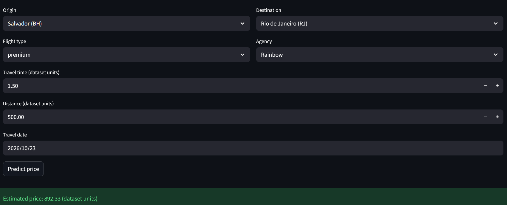

### 2. Hotel Recommendation

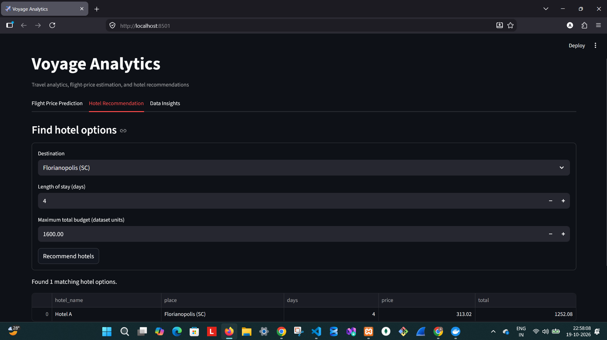

### 3. Flight Data Insights

**Overview**

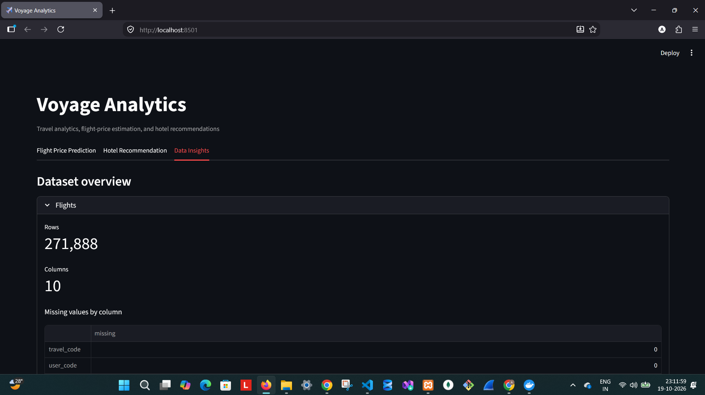

**Missing values**

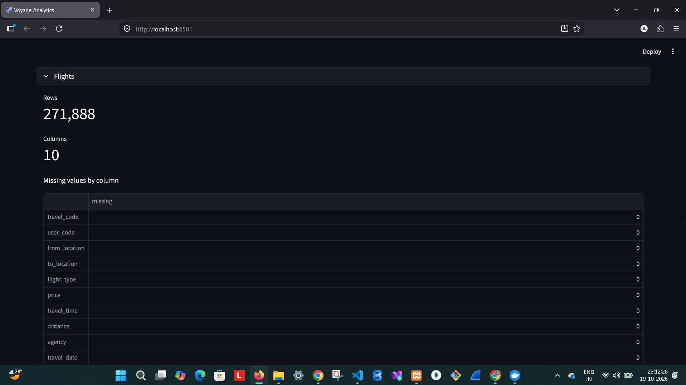

**Data preview**

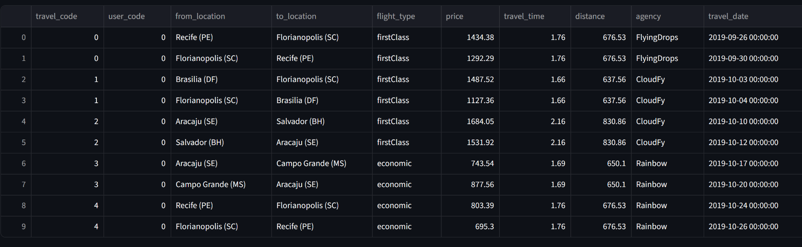

### 4. Hotel Data Insights

**Overview**

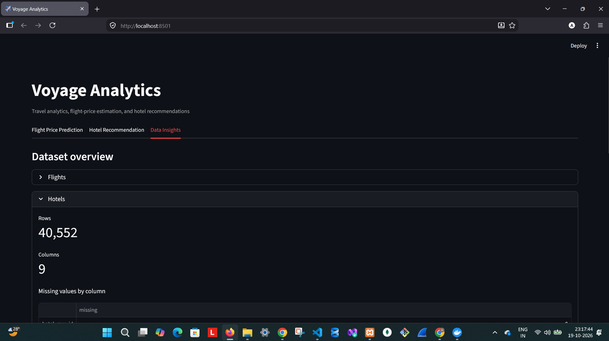

**Missing values**

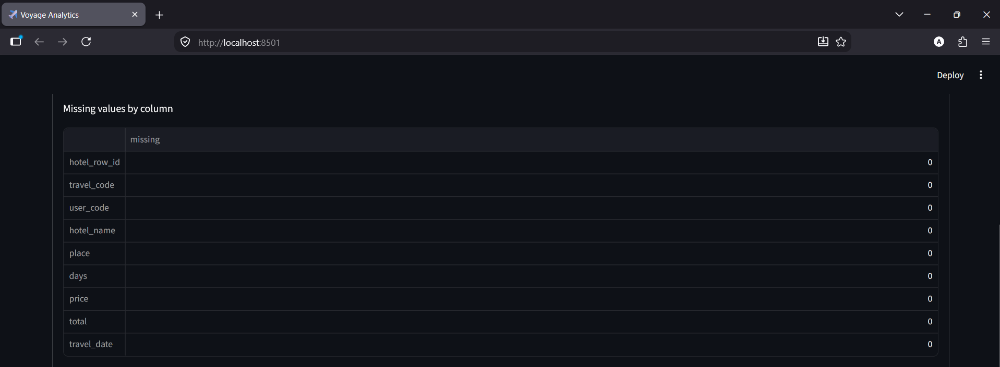

**Data preview**

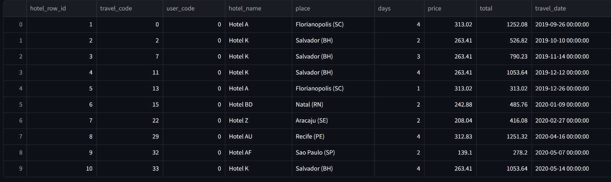

### 5. User Data Insights

**Overview**

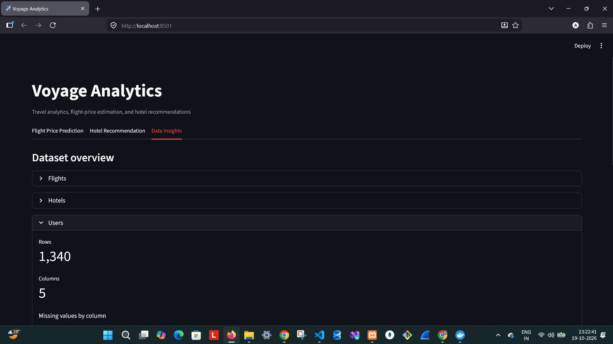

**Missing values**

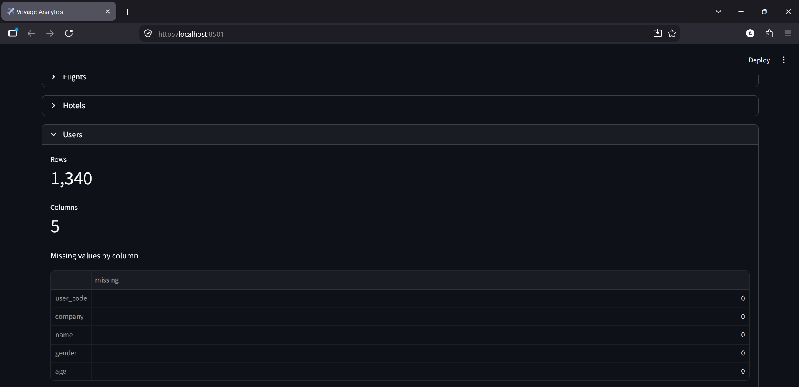

**Data preview**

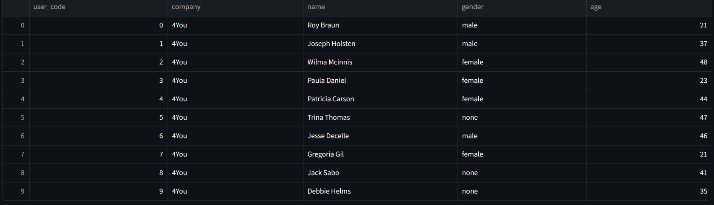

### 6. MySQL History Verification

**Prediction history**

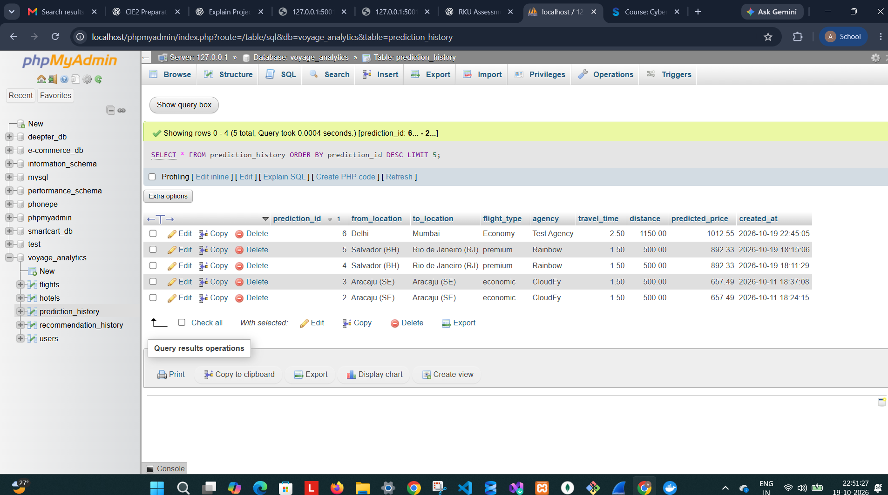

**Recommendation history**

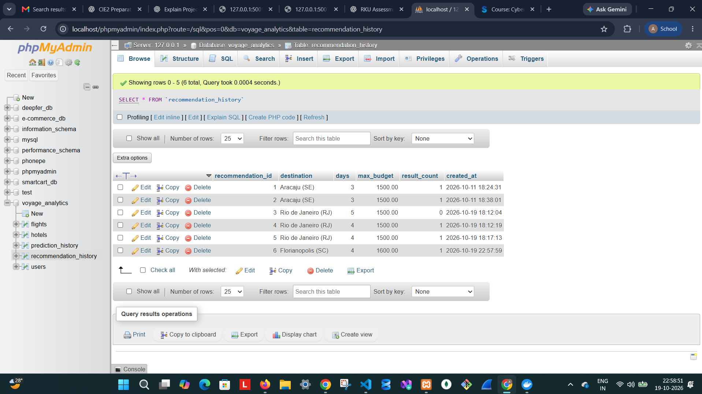

## Important Notes

- Predicted flight prices are expressed in the units represented by the supplied dataset. Do not label them as INR unless the dataset currency has been verified.
- Hotel prices and budgets are also displayed in dataset units.
- Machine-learning results depend on the supplied data and training process.
- Keep passwords, API keys, and other secrets out of source control.
- The Flask development server is suitable for local development and demonstration, not production deployment.
- The gender-classification model is an additional educational component; it is separate from the main flight-price prediction and hotel-recommendation workflows.

## Future Improvements

- Add automated tests for API endpoints and data-access functions.
- Add model evaluation metrics and documented validation results.
- Improve API error handling and production serving configuration.
- Add authentication and access controls if the application is exposed beyond the local environment.
- Automate model and deployment checks through a CI/CD workflow.

## Conclusion

Voyage Analytics demonstrates an integrated travel analytics workflow involving machine learning, interactive data exploration, hotel recommendations, database-backed history, REST API development, Docker containerization, and Kubernetes deployment.
